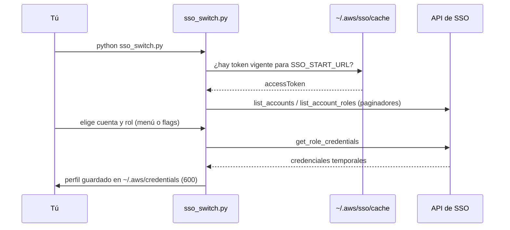

# 01 · Acceso multicuenta

**El problema:** tienes varias cuentas de AWS (dev, staging, prod) y cambiar entre ellas es
una secuencia de clics, copiar y pegar credenciales y rezar para no estar en la cuenta equivocada.

**La automatización:** un comando que te deja un perfil listo en `~/.aws/credentials`,
con nombre claro y fecha de vencimiento visible.

Hay dos escenarios, según cómo entres a AWS:

| Escenario | Script | Cuándo usarlo | Guía |
|---|---|---|---|
| SSO (IAM Identity Center) | `sso_switch.py` | Tu organización usa el portal de acceso de AWS | [docs/04](../docs/04-configurar-sso.md) |
| Cuenta puente | `hub_switch.py` | Entras a una cuenta y desde ahí asumes roles en las demás | [docs/05](../docs/05-crear-roles-cuenta-puente.md) |

Los dos son de solo lectura sobre AWS: no crean ni modifican recursos. Lo único que escriben
es tu archivo local de credenciales, con permisos `600` (solo tu usuario puede leerlo).

---

## `sso_switch.py`

### Cómo funciona



1. Busca en `~/.aws/sso/cache/*.json` el token que dejó `aws sso login` para tu start URL.
   Si no hay uno vigente, termina y te pide `aws sso login`.
2. Lista cuentas y roles con los paginadores de `sso` (`list_accounts`, `list_account_roles`).
3. Pide credenciales con `sso.get_role_credentials` y las guarda como perfil `<cuenta>-<rol>`.
4. Si indicas `--cluster`, ejecuta `aws eks update-kubeconfig --profile <perfil>`.

### La duración de la sesión la define el permission set

Con SSO, las credenciales duran lo que diga el **permission set** (de 1 a 12 h, se configura en
IAM Identity Center → *Permission sets* → *Session duration*). `get_role_credentials` **no
recibe un parámetro de duración**, así que este script no tiene `--duration`. Si necesitas
sesiones más largas, cambia el permission set.

### Uso

```bash
# Menú interactivo
python 01-acceso-multicuenta/sso_switch.py --start-url https://d-1234567890.awsapps.com/start

# Sin preguntas, ideal para un alias
python 01-acceso-multicuenta/sso_switch.py --account staging --role ReadOnlyAccess

# Como en la charla: perfil "caro" y kubeconfig para un cluster EKS
python 01-acceso-multicuenta/sso_switch.py --profile-name caro --cluster eks-dev
```

`--start-url`, `--sso-region` y `--cluster` toman sus valores de `SSO_START_URL`, `SSO_REGION` y
`EKS_CLUSTER_NAME` si no los pasas. Si tienes un cluster EKS, **reemplaza `EKS_CLUSTER_NAME` en tu `.env`
por el nombre de tu cluster**: el contexto del kubeconfig queda con ese mismo nombre, y los scripts 03,
04 y 05 lo usan si defines `KUBE_CONTEXT` igual. Si no tienes cluster, deja la variable vacía.

Ejemplo de salida (el último comando, con el menú):

```text
  1) prod (222222222222)
  2) staging (111111111111)
? Cuenta (1-2) › 2
? Cuenta › staging (111111111111)
  1) AdministratorAccess
  2) EKSDeveloper
  3) ReadOnlyAccess
? Rol (1-3) › 2
? Rol › EKSDeveloper
✓ perfil caro · expira 16:32 (en 3 h 59 min)
  staging (111111111111) · EKSDeveloper · /home/caro/.aws/credentials
✓ kubeconfig → eks-dev

Prueba: aws sts get-caller-identity --profile caro
```

> **¿Y si ya tengo perfiles SSO en `~/.aws/config`?** La CLI v2 y boto3 ya saben usar perfiles
> SSO directamente. Este script es útil cuando tienes muchas cuentas y no quieres mantener un
> perfil por cada combinación cuenta + rol, o cuando una herramienta solo entiende
> `~/.aws/credentials`.

---

## `hub_switch.py`

### Cómo funciona

1. Usa el perfil de la cuenta puente (`HUB_PROFILE` o `--hub-profile`) y busca el ID de la
   cuenta destino en `HUB_ACCOUNTS` (por ejemplo `dev=111111111111,prod=333333333333`), o en `--account`.
2. Valida la duración: acepta `30m`, `1h`, `1h30m` y exige entre 15 min y 12 h.
3. Llama a `sts.get_caller_identity`. Si tu ARN contiene `assumed-role`, ya estás en un rol:
   eso es **role chaining** y AWS limita la sesión a 1 h. El script rechaza pedidos mayores
   con un mensaje claro.
4. Llama a `sts.assume_role` hacia `arn:aws:iam::<cuenta>:role/<rol>` con `DurationSeconds`.
5. Guarda el perfil `<env>-<rol>` y te dice cuándo vence.

### Uso

Recibe tres argumentos: ambiente, rol (por defecto `ReadOnly`) y duración (por defecto `1h`).

```bash
export HUB_ACCOUNTS="dev=111111111111,staging=222222222222,prod=333333333333"
python 01-acceso-multicuenta/hub_switch.py prod ReadOnly 30m
python 01-acceso-multicuenta/hub_switch.py dev Admin 15m
```

Salida (verificada contra un emulador local de STS):

```text
✓ prod/ReadOnly · vence en 30 min (12:59)
  perfil 'prod-readonly' guardado en /home/caro/.aws/credentials
  rol: arn:aws:iam::333333333333:role/ReadOnly

Prueba: aws sts get-caller-identity --profile prod-readonly
```

```text
✓ dev/Admin · vence en 15 min (12:44)
  perfil 'dev-admin' guardado en /home/caro/.aws/credentials
  rol: arn:aws:iam::111111111111:role/Admin
```

Si entras a la cuenta puente con SSO y pides más de 1 h:

```text
Error: Tu identidad en la cuenta puente ya es un rol asumido (arn:aws:sts::111111111111:assumed-role/Hub/caro).
Eso es role chaining y AWS limita la sesión a 1 h. Pediste 1h30m: pide 1h o menos, o entra a la cuenta puente con un usuario IAM o SSO directo.
```

Si la trust policy exige MFA:

```bash
python 01-acceso-multicuenta/hub_switch.py prod ReadOnly 1h \
  --mfa-serial arn:aws:iam::111111111111:mfa/caro --mfa-code 123456
```

### Probarlo sin cuenta de AWS

Con el laboratorio levantado (`make lab-up` y `source lab/lab.env`), LocalStack emula STS:

```bash
python 01-acceso-multicuenta/hub_switch.py lab ReadOnly 1h --account 000000000000
```

## Tests

```bash
pytest tests/test_sso_switch.py tests/test_hub_switch.py -v
```

La API de SSO se prueba con `botocore.stub.Stubber` (moto no la emula) y STS/IAM con `moto`.
Se cubren token vencido, token inválido, duración fuera de rango, role chaining y permisos `600`.
