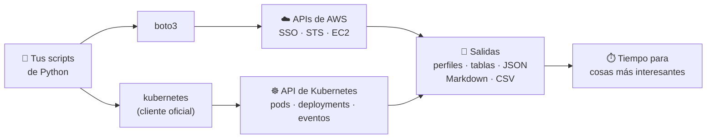

# 5 cosas que puedes automatizar hoy con Python si eres DevOps

**De tareas repetitivas a pequeños scripts que te devuelven tiempo**

[](https://www.python.org/)
[](LICENSE)
[](https://github.com/carotechie/python-automatiza-devops/actions/workflows/ci.yml)
[](https://pyladies.com/)
[](https://docs.google.com/presentation/d/142oJcFDnBLSh6bWCx5NPI1e3EzgdBzDF2V2MMOxDpx8/edit?usp=sharing)

📽️ **Diapositivas de la charla:** [5 cosas que puedes automatizar hoy con Python si eres DevOps](https://docs.google.com/presentation/d/142oJcFDnBLSh6bWCx5NPI1e3EzgdBzDF2V2MMOxDpx8/edit?usp=sharing)

---

## Quién soy

Soy **Carolina Herrera** (Caro Herrera), DevOps Engineer con más de 10 años de experiencia en
infraestructura cloud, automatización y sistemas críticos. Soy **AWS Community Builder** en la
categoría Cloud Operations, lidero el grupo de usuarios **AWS Girls UG Uruguay** y creo
contenido técnico bilingüe para LATAM como **carotechie**.

Contacto y redes: [tech.carolinaherreramonteza.com](https://tech.carolinaherreramonteza.com/#contact)

## ¿Qué es este repo?

Es el material de mi charla relámpago para PyLadies. Tiene 5 scripts de Python que resuelven
tareas que todo equipo DevOps repite cada semana, un laboratorio local para correrlos sin
gastar nada y retos para que armes tus propias automatizaciones.

> **Python no tiene que hacer tu trabajo. Tiene que devolverte tiempo para hacer cosas más interesantes.**

Cada automatización tiene su diapositiva con un fragmento del código. Acá está la versión
completa: con manejo de errores, `--help`, paginadores y tests. Si estuviste en la charla, abre
las [diapositivas](https://docs.google.com/presentation/d/142oJcFDnBLSh6bWCx5NPI1e3EzgdBzDF2V2MMOxDpx8/edit?usp=sharing) al lado y sigue el mismo orden.



## Las 5 automatizaciones

| # | Problema | Qué hace el script | Tiempo que te ahorra | Carpeta |
|---|---|---|---|---|
| 1 | Cambiar de cuenta y rol en AWS es una secuencia de clics y copiar credenciales | Obtiene credenciales temporales por SSO o cuenta puente y las guarda como perfil | ~5 min cada vez que cambias de cuenta | [`01-acceso-multicuenta`](01-acceso-multicuenta/) |
| 2 | "¿En qué región quedó esa instancia?" | Busca EC2 en varias regiones filtrando por tags y estado | ~10 min por búsqueda | [`02-buscar-recursos`](02-buscar-recursos/) |
| 3 | Encontrar a ojo los pods rotos entre cientos | Lista solo los pods con fallas y devuelve exit code 1 | ~5 min por revisión, y se puede agendar | [`03-pods-con-fallas`](03-pods-con-fallas/) |
| 4 | Los primeros 10 minutos de cada incidente son los mismos comandos | Junta estado, pods caídos, eventos y logs en un Markdown | ~10 min por incidente | [`04-triage-incidentes`](04-triage-incidentes/) |
| 5 | Armar a mano el reporte de los lunes | Cuenta EC2 y pods por ambiente y genera Markdown, CSV o JSON | ~30 min por semana | [`05-reportes`](05-reportes/) |

Los tiempos son estimaciones de uso típico. Todos los scripts son **de solo lectura**: no
modifican ni borran recursos.

## Elige tu camino

| | Camino A · Sin cuenta de AWS | Camino B · Con cuenta y SSO | Camino C · Con cuenta puente |
|---|---|---|---|
| **Para quién** | Quieres probar todo ya, sin gastar | Tienes (o vas a crear) una cuenta con IAM Identity Center | Entras a una cuenta y asumes roles en otras |
| **Usa** | LocalStack + kind | AWS real + kind | AWS real + kind |
| **Tiempo de preparación** | ~10 minutos | ~40 minutos | ~40 minutos |
| **Costo** | 0 | 0 si te quedas en llamadas de lectura | 0 si te quedas en llamadas de lectura |
| **Guías** | [Python](docs/01-instalar-python.md) · [Kubernetes local](docs/06-kubernetes-local.md) | + [AWS CLI](docs/02-instalar-aws-cli.md) · [Cuenta](docs/03-crear-cuenta-aws.md) · [SSO](docs/04-configurar-sso.md) | + [Roles de la cuenta puente](docs/05-crear-roles-cuenta-puente.md) |

### ¿Qué necesito para cada script?

| Script | Python | AWS CLI | Cuenta AWS o LocalStack | SSO | Kubernetes |
|---|:---:|:---:|:---:|:---:|:---:|
| `sso_switch.py` | ✅ | ✅ (`aws sso login`) | Cuenta AWS | ✅ | Opcional (`--cluster`, EKS) |
| `hub_switch.py` | ✅ | Opcional | Cualquiera de las dos | ❌ | ❌ |
| `find_ec2.py` | ✅ | ❌ | Cualquiera de las dos | ❌ | ❌ |
| `pods_check.py` | ✅ | ❌ | ❌ | ❌ | ✅ |
| `triage.py` | ✅ | ❌ | ❌ | ❌ | ✅ |
| `weekly_report.py` | ✅ | ❌ | Cualquiera de las dos | ❌ | Opcional (`--skip-k8s`) |

## Inicio rápido (camino A)

Necesitas Python 3.10+, Docker, kubectl y kind ([guía 1](docs/01-instalar-python.md) y [guía 6](docs/06-kubernetes-local.md)).

```bash
git clone https://github.com/carotechie/python-automatiza-devops.git && cd python-automatiza-devops
make setup
make lab-up
source .venv/bin/activate && source lab/lab.env
python 02-buscar-recursos/find_ec2.py --tag env=staging
```

`make lab-up` levanta LocalStack, crea 3 instancias EC2 de ejemplo, crea el cluster kind
`pyladies-lab` y despliega apps que fallan a propósito, incluido un deploy de `checkout` que
rompe la conexión a la base. Después, `make demo` corre los scripts 02 a 05 contra el laboratorio.
Cuando termines: `make lab-down`.

<details>
<summary><strong>En Windows (sin make)</strong></summary>

```powershell
git clone https://github.com/carotechie/python-automatiza-devops.git; cd python-automatiza-devops
py -m venv .venv; .\.venv\Scripts\Activate.ps1; pip install -r requirements-dev.txt
docker compose -f lab/docker-compose.yml up -d --wait
. .\lab\lab.env.ps1; python lab/seed_localstack.py
kind create cluster --config lab/kind-config.yaml; kubectl --context kind-pyladies-lab apply -f lab/k8s-broken/
kubectl --context kind-pyladies-lab -n lab rollout status deployment/checkout --timeout=180s
kubectl --context kind-pyladies-lab apply -f lab/k8s-broken/incident/
python 02-buscar-recursos/find_ec2.py --tag env=staging
```

</details>

> **Si tienes otros clusters en tu kubeconfig**, no te preocupes: `lab/lab.env` define
> `KUBE_CONTEXT=kind-pyladies-lab` y los scripts de Kubernetes lo usan por defecto, así no
> apuntas a otro cluster por accidente.

## ¿Ya tienes un cluster de Kubernetes (EKS u otro)?

Los scripts 03, 04 y 05 funcionan con **cualquier cluster** al que llegue tu kubeconfig: EKS,
GKE, AKS, k3s o minikube. Son de solo lectura, así que puedes probarlos en un cluster de
desarrollo sin miedo a romper nada.

1. Copia `.env.example` como `.env` y **reemplaza estas variables** con los datos de tu cluster:

   ```bash
   EKS_CLUSTER_NAME=eks-dev   # el nombre de tu cluster EKS
   KUBE_CONTEXT=eks-dev       # el contexto de kubeconfig que usarán los scripts
   AWS_REGION=us-east-1       # la región de tu cluster
   ```

2. Carga las variables y crea el contexto (con SSO, `sso_switch.py` lo hace por ti):

   ```bash
   set -a && source .env && set +a
   aws eks update-kubeconfig --name "$EKS_CLUSTER_NAME" --region "$AWS_REGION" --alias "$KUBE_CONTEXT"
   ```

3. Corre los scripts con un namespace y una app tuyos:

   ```bash
   python 03-pods-con-fallas/pods_check.py --namespace <tu-namespace>
   python 04-triage-incidentes/triage.py --namespace <tu-namespace> --app <tu-deployment>
   ```

Necesitas permisos de `get` y `list` sobre pods, deployments, replicasets y eventos, y `get` sobre
`pods/log` (los detalles están en el README de cada carpeta). Si no tienes un cluster, **no crees uno
en EKS solo para practicar**: el plano de control cobra por hora desde que existe (unos 73 USD al mes).
Usa kind: es gratis y los scripts se comportan igual. Más detalles en la [guía 6](docs/06-kubernetes-local.md#usar-tu-propio-cluster-eks-u-otro).

## Los scripts en acción

<details>
<summary><strong>1 · Acceso multicuenta</strong> (<code>sso_switch.py</code> y <code>hub_switch.py</code>)</summary>

Con SSO (camino B):

```bash
python 01-acceso-multicuenta/sso_switch.py --account staging --role ReadOnlyAccess
```

```text
✓ perfil staging-readonlyaccess · expira 16:32 (en 3 h 59 min)
  staging (111111111111) · ReadOnlyAccess · /home/caro/.aws/credentials

Prueba: aws sts get-caller-identity --profile staging-readonlyaccess
```

Con cuenta puente (camino C). Los IDs de cada ambiente salen de `HUB_ACCOUNTS` en tu `.env`:

```bash
python 01-acceso-multicuenta/hub_switch.py prod ReadOnly 30m
```

```text
✓ prod/ReadOnly · vence en 30 min (12:59)
  perfil 'prod-readonly' guardado en /home/caro/.aws/credentials
  rol: arn:aws:iam::333333333333:role/ReadOnly

Prueba: aws sts get-caller-identity --profile prod-readonly
```

Más detalles, role chaining y MFA en [`01-acceso-multicuenta/`](01-acceso-multicuenta/).

</details>

<details>
<summary><strong>2 · Buscar recursos</strong> (<code>find_ec2.py</code>)</summary>

```bash
python 02-buscar-recursos/find_ec2.py --endpoint-url http://localhost:4566 --tag env=staging
```

```text
| Región    | ID                  | Nombre            | Tipo     | Estado   | IP privada     | Creada                    |
|-----------|---------------------|-------------------|----------|----------|----------------|---------------------------|
| eu-west-1 | i-7b056af9955d324b1 | api-staging-01    | t3.small | stopped  | 10.162.164.147 | 2026-10-10T15:29:21+00:00 |
| sa-east-1 | i-571d085dba638a5b8 | worker-staging-01 | t3.micro | running  | 10.226.164.212 | 2026-10-10T15:29:21+00:00 |
| us-east-1 | i-d24bdb7df17f6c1bd | web-staging-01    | t3.micro | running  | 10.127.113.202 | 2026-10-10T15:29:21+00:00 |

3 instancia(s) en 3 región(es).
```

Con `--output json` obtienes la lista completa con todos los tags.

</details>

<details>
<summary><strong>3 · Pods con fallas</strong> (<code>pods_check.py</code>)</summary>

```bash
python 03-pods-con-fallas/pods_check.py
```

> Salida de ejemplo. Con el laboratorio levantado, `make demo` te muestra la tuya.

```text
| Namespace   | Pod                          | Contenedor   | Razón            |   Reinicios |
|-------------|------------------------------|--------------|------------------|-------------|
| lab         | broken-image-7b9c8d5f4-mz2lq | app          | ImagePullBackOff |           0 |
| lab         | checkout-59d8f7c6b4-7lx2c    | checkout     | CrashLoopBackOff |           4 |
| lab         | checkout-59d8f7c6b4-v8n4k    | checkout     | CrashLoopBackOff |           4 |
| lab         | crashloop-5f6b7c8d9-hk3jd    | app          | CrashLoopBackOff |           5 |
| lab         | too-big-84c7d9f6b-wq9rt      | -            | Unschedulable    |           0 |

5 de 17 pods con problemas
```

Exit code `1` porque hay problemas. Los sufijos de los pods cambian en tu cluster.

</details>

<details>
<summary><strong>4 · Triage de incidentes</strong> (<code>triage.py</code>)</summary>

```bash
python 04-triage-incidentes/triage.py --namespace lab --app checkout
```

> Salida de ejemplo. Con el laboratorio levantado, `make demo` te muestra la tuya.

```text
# Resumen de incidente: checkout

- **Namespace:** `lab`
- **Estado:** DEGRADADO (1/3 réplicas listas)

## Deployment
| Versión | v2.4.1 |
| Revisión | 2 · v2.4.1: mueve el carrito a postgres |
| Último rollout | 2026-10-10 15:37:01 UTC (hace 12 min) |

## Pods que no están listos
| Pod | Fase | Razón | Reinicios | Nodo |
|---|---|---|---|---|
| checkout-59d8f7c6b4-7lx2c | Running | CrashLoopBackOff | 4 | pyladies-lab-control-plane |
| checkout-59d8f7c6b4-v8n4k | Running | CrashLoopBackOff | 4 | pyladies-lab-control-plane |

## Logs
Últimas 20 líneas del log anterior (`previous=True`) de `checkout-59d8f7c6b4-7lx2c`:
connecting to postgres at db:5432
attempt 3/3: could not connect to db:5432
ConnectionError: could not connect to db:5432
...
Resumen guardado en incident-summary-checkout-20261010-154901.md
```

En 10 segundos sabes que el problema empezó con el cambio a v2.4.1 y que es la conexión a la base.
El script **no arregla nada**: te ahorra los primeros minutos de investigación.
El resumen completo está en [`04-triage-incidentes/`](04-triage-incidentes/).

</details>

<details>
<summary><strong>5 · Reportes</strong> (<code>weekly_report.py</code>)</summary>

```bash
python 05-reportes/weekly_report.py --env dev --env staging --skip-k8s
```

```text
# Reporte semanal de infraestructura

- **Generado:** 2026-10-10 15:48 UTC
- **Regiones:** us-east-1, eu-west-1, sa-east-1

| Ambiente   |   EC2 total |   EC2 en ejecución |
|:-----------|------------:|-------------------:|
| dev        |           0 |                  0 |
| staging    |           3 |                  2 |
| TOTAL      |           3 |                  2 |
```

El workflow [`weekly-report.yml`](.github/workflows/weekly-report.yml) lo genera solo los lunes a las 09:00 UTC contra LocalStack.

</details>

## Bonus: crea tu propia automatización

12 retos con contexto, pistas y criterios de aceptación. Sin soluciones: te toca a ti.

| Nivel | Retos |
|---|---|
| 🟢 Básico | [01 · Volúmenes EBS sin adjuntar](bonus/retos/01-volumenes-ebs-sin-adjuntar.md) · [02 · Elastic IPs sin usar](bonus/retos/02-elastic-ips-sin-usar.md) · [03 · Buckets S3 públicos](bonus/retos/03-buckets-s3-publicos.md) · [04 · Access keys de más de 90 días](bonus/retos/04-access-keys-viejas.md) |
| 🟡 Intermedio | [05 · Incidente a Slack o Teams](bonus/retos/05-incidente-a-slack-o-teams.md) · [06 · Tags obligatorios](bonus/retos/06-validar-tags-obligatorios.md) · [07 · Costos de 7 días](bonus/retos/07-costos-ultimos-7-dias.md) · [08 · pods_check como CronJob](bonus/retos/08-pods-check-cronjob.md) |
| 🔴 Avanzado | [09 · CLI única con typer y rich](bonus/retos/09-cli-unica-con-typer.md) · [10 · Alerta de credenciales por vencer](bonus/retos/10-alerta-credenciales-por-vencer.md) · [11 · Reporte en GitHub Pages](bonus/retos/11-reporte-en-github-pages.md) · [12 · Tests con moto y cobertura](bonus/retos/12-tests-con-moto-y-cobertura.md) |

Detalles y reglas en [`bonus/`](bonus/).

## Seguridad

- **Nunca subas credenciales.** `.env`, `*.pem`, `.aws/` y kubeconfigs están en `.gitignore`. Revisa igual antes de cada commit.
- **Usa perfiles y credenciales temporales.** Los scripts trabajan con perfiles (`--profile`) y credenciales de SSO o STS que vencen solas. Evita las access keys de larga duración.
- **Mínimo privilegio.** Todo funciona con `ReadOnlyAccess` en AWS y con permisos de `get`/`list` en Kubernetes.
- **Detecta secretos antes del commit** con `pre-commit` y `detect-secrets` (ya configurado en [`.pre-commit-config.yaml`](.pre-commit-config.yaml)):

  ```bash
  pip install pre-commit
  pre-commit install
  ```

- **Usa IDs ficticios en ejemplos, issues y capturas** (`111111111111`, `123456789012`). Un ID de cuenta no es un secreto, pero sí información que no hace falta regalar.
- El archivo de credenciales que escriben los scripts del módulo 01 queda con permisos `600`.

## ¿Qué automatizar?

Los 4 criterios de la charla. Una tarea es buena candidata si:

1. **La haces seguido.** Todos los días, todas las semanas, en cada incidente.
2. **Es repetitiva.** Los mismos pasos, en el mismo orden.
3. **Es fácil equivocarse.** Copiar y pegar credenciales, mirar la cuenta equivocada.
4. **Consume tiempo.** Minutos que se suman semana a semana.

**Regla de 3 de 4:** si cumple al menos 3, automatízala. Si cumple 1 o 2, probablemente un
alias o una nota alcancen.

## Cómo contribuir

Lee [CONTRIBUTING.md](CONTRIBUTING.md). Para trabajar en el repo:

```bash
make setup   # entorno virtual + dependencias de desarrollo
make lint    # ruff
make test    # pytest (moto, Stubber y mocks: no necesitas cuenta de AWS)
```

## Licencia

[MIT](LICENSE). Úsalo, cámbialo y compártelo.

---

**¿Qué tarea repetitiva hiciste esta semana que no quieres volver a hacer la próxima?**

Cuéntamela en un issue o en redes: puede ser el próximo script de este repo.

📽️ [Diapositivas de la charla](https://docs.google.com/presentation/d/142oJcFDnBLSh6bWCx5NPI1e3EzgdBzDF2V2MMOxDpx8/edit?usp=sharing) · 🌐 [tech.carolinaherreramonteza.com](https://tech.carolinaherreramonteza.com/#contact)
# python-automate-devops-tasks
# python-automate-devops-tasks
# python-automate-devops-tasks
# python-automate-devops-tasks
# python-automate-devops-tasks
