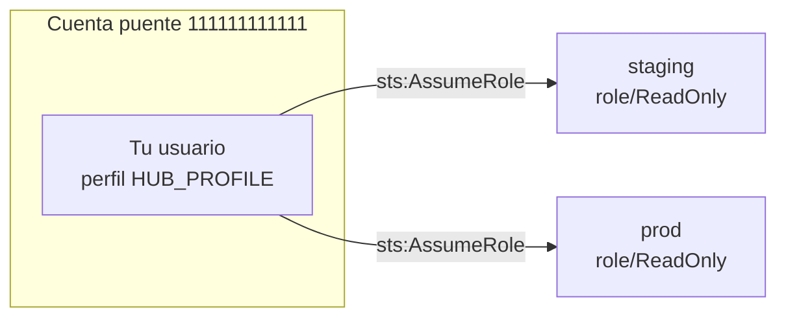

# 5 · Crear los roles para la cuenta puente

Este es el modelo que usa `01-acceso-multicuenta/hub_switch.py`. Es útil cuando no tienes
IAM Identity Center, o cuando una herramienta (un pipeline, un bastión) entra siempre por
una sola cuenta.

Todos los IDs son ficticios:

| Cuenta | ID | Rol |
|---|---|---|
| Puente (hub) | `111111111111` | Donde viven tus usuarios o tu acceso inicial |
| Staging | `222222222222` | Tiene el rol `ReadOnly` |
| Producción | `333333333333` | Tiene el rol `ReadOnly` |

## El modelo



Para que el `AssumeRole` funcione hacen falta **dos permisos**, uno de cada lado:

1. En la **cuenta destino**, la *trust policy* del rol dice "confío en la cuenta puente".
2. En la **cuenta puente**, la política de tu usuario dice "puedo asumir estos roles".

Si falta cualquiera de los dos, recibes `AccessDenied`.

## Paso 1: trust policy en cada cuenta destino

`infra/iam/trust-policy.json`:

```json
{
  "Version": "2012-10-17",
  "Statement": [
    {
      "Sid": "AllowHubAccount",
      "Effect": "Allow",
      "Principal": { "AWS": "arn:aws:iam::111111111111:root" },
      "Action": "sts:AssumeRole"
    }
  ]
}
```

### Con MFA (opcional, recomendado)

`infra/iam/trust-policy-mfa.json` agrega una condición: solo se puede asumir el rol si la
sesión tiene MFA. En ese caso usa `hub_switch.py prod ReadOnly 1h --mfa-serial arn:aws:iam::111111111111:mfa/caro --mfa-code 123456`.

```json
"Condition": {
  "Bool": { "aws:MultiFactorAuthPresent": "true" },
  "NumericLessThan": { "aws:MultiFactorAuthAge": "43200" }
}
```

## Paso 2: crea el rol con `ReadOnlyAccess` y su `MaxSessionDuration`

En cada cuenta destino (con credenciales de administrador **de esa cuenta**):

```bash
aws iam create-role \
  --role-name ReadOnly \
  --assume-role-policy-document file://infra/iam/trust-policy.json \
  --max-session-duration 14400 \
  --description "Solo lectura desde la cuenta puente"

aws iam attach-role-policy \
  --role-name ReadOnly \
  --policy-arn arn:aws:iam::aws:policy/ReadOnlyAccess
```

`--max-session-duration` va de `3600` (1 h, el valor por defecto) a `43200` (12 h).
La duración que le pasas a `hub_switch.py` no puede ser mayor: si pides 4 h y el rol permite 1 h,
AWS responde `ValidationError` y el script te lo explica.

Para cambiarlo después:

```bash
aws iam update-role --role-name ReadOnly --max-session-duration 43200
```

### Con CloudFormation

`infra/cloudformation/target-readonly-role.yaml` hace lo mismo con parámetros:

```bash
aws cloudformation deploy \
  --template-file infra/cloudformation/target-readonly-role.yaml \
  --stack-name hub-readonly-role \
  --capabilities CAPABILITY_NAMED_IAM \
  --parameter-overrides HubAccountId=111111111111 MaxSessionDuration=14400 RequireMFA=false
```

Si tienes AWS Organizations, puedes desplegarla en todas las cuentas a la vez con
**CloudFormation StackSets**.

## Paso 3: política en la cuenta puente

En la cuenta puente, dale a tu usuario (o mejor, a un grupo) permiso para asumir **solo**
esos roles. `infra/iam/hub-assume-policy.json`:

```json
{
  "Effect": "Allow",
  "Action": "sts:AssumeRole",
  "Resource": [
    "arn:aws:iam::222222222222:role/ReadOnly",
    "arn:aws:iam::333333333333:role/ReadOnly"
  ]
}
```

```bash
aws iam create-group --group-name hub-readonly-switchers
aws iam put-group-policy \
  --group-name hub-readonly-switchers \
  --policy-name assume-readonly-targets \
  --policy-document file://infra/iam/hub-assume-policy.json
aws iam add-user-to-group --group-name hub-readonly-switchers --user-name caro
```

O con CloudFormation:

```bash
aws cloudformation deploy \
  --template-file infra/cloudformation/hub-assume-group.yaml \
  --stack-name hub-assume-group \
  --capabilities CAPABILITY_NAMED_IAM \
  --parameter-overrides TargetAccountIds=222222222222,333333333333
```

## Paso 4: configura el perfil de la cuenta puente

En `~/.aws/config`, el perfil de la cuenta puente puede ser SSO o un usuario IAM:

```ini
[profile hub]
sso_session = lab
sso_account_id = 111111111111
sso_role_name = HubAccess
region = us-east-1
```

Y en `.env`, el perfil y el ID de cada ambiente:

```bash
HUB_PROFILE=hub
HUB_ACCOUNTS=staging=222222222222,prod=333333333333
```

## El límite de 1 h por role chaining

*Role chaining* es asumir un rol **usando credenciales que ya vienen de otro rol**. AWS
limita esas sesiones a **1 hora como máximo**, sin importar el `MaxSessionDuration` del rol destino.

| Tu identidad en la cuenta puente | ARN de `get-caller-identity` | Máximo |
|---|---|---|
| Usuario IAM | `arn:aws:iam::111111111111:user/caro` | Hasta el `MaxSessionDuration` del destino (12 h) |
| Rol asumido o SSO | `arn:aws:sts::111111111111:assumed-role/...` | **1 h** |

Ojo: **si entras a la cuenta puente con SSO, ya estás en un rol**, así que cualquier
`AssumeRole` desde ahí es role chaining. `hub_switch.py` lo detecta mirando si tu ARN contiene
`assumed-role` y rechaza pedidos de más de 1 h con un mensaje claro, en lugar de dejar que
AWS falle con un error genérico.

## Variante: tengo una sola cuenta

Puedes practicar el mismo flujo dentro de una sola cuenta:

1. Crea un usuario IAM `caro-practica` con access keys (solo para practicar; borra las keys al terminar).
2. Crea el rol `ReadOnly` con una trust policy que confíe en **tu misma cuenta**
   (reemplaza `111111111111` por tu ID en `trust-policy.json`).
3. Dale al usuario la política `hub-assume-policy.json` apuntando a
   `arn:aws:iam::<tu-cuenta>:role/ReadOnly`.
4. Configura el perfil:

   ```bash
   aws configure --profile hub
   ```

5. Asume el rol:

   ```bash
   python 01-acceso-multicuenta/hub_switch.py practica ReadOnly 2h --account <tu-cuenta> --hub-profile hub
   ```

Como entras con un usuario IAM (no con un rol), no hay role chaining y puedes pedir hasta el
`MaxSessionDuration` del rol.

## Cómo verificar que funcionó

```bash
aws sts get-caller-identity --profile hub
python 01-acceso-multicuenta/hub_switch.py staging ReadOnly 1h
aws sts get-caller-identity --profile staging-readonly
```

El último comando tiene que mostrar `arn:aws:sts::222222222222:assumed-role/ReadOnly/hub-switch-<tu-usuario>`.
